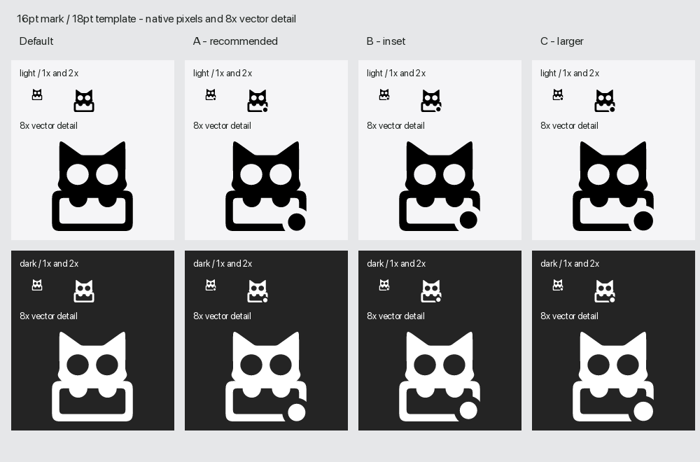

# 菜单栏常亮点 · 2026-10-29

目标：把 R05 的开启加点方案落到品牌源中的矢量层，保留维护者确认的母版及默认导出物。

对照从当前母版经过导出器的同一矢量排版和遮罩流程生成。每列上排显示原始 1×/2× 像素，下排显示 8× 矢量细节；这是静态模板预览。

候选 A：中心 (780,850)，直径 152 / 留白圆 252；候选 B：中心 (764,832)，直径相同；候选 C：中心 (776,840)，直径 168 / 留白圆 268。推荐 A：靠近箱角，满足 3pt 点和 1pt 留白的下限，遮挡比 C 小，角标位置感比 B 明确。画板仅保留 A，维护者仍可在 pen.dev 微调。详见 [品牌规则和调点方法](../../README.md#常亮状态与候选)。

规则：状态源只有两个同心正圆，留白用于擦除透明通道；模板保持 18×18pt、猫标高 16pt、中心 (9,9)，不按点重新计算布局。母版 `n0a0W` 完整子树未改变，原有 15 个 PNG/SVG 文件的 SHA-256 与变更前相同。

验证：导出器 `--check`、5 项 unittest、品牌画板原生复开和间距检查（120 ≥ 80）、`./scripts/selftest.sh` 全部通过。候选图已复核浅深背景和各尺寸。应用的常亮状态接入不属于本次品牌资产交付。
